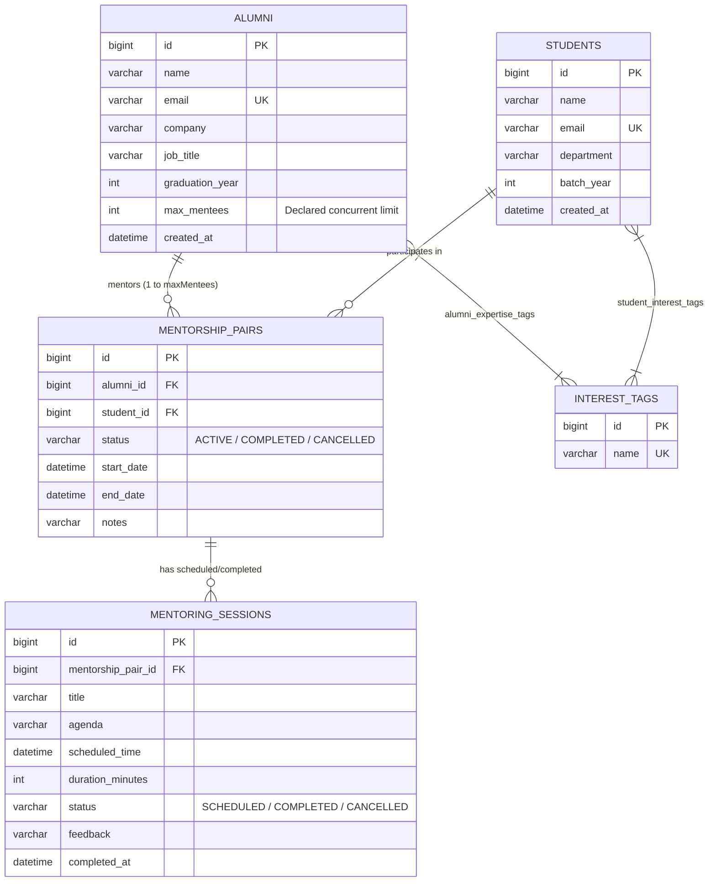

# MentorConnect — Alumni-Student Mentorship Matching Platform

> **Comprehensive Full-Stack Backend Project** implementing **Maven**, **Spring Boot**, **MySQL Workbench**, and **Postman**.
> Based on **Question 65: Alumni-Student Mentorship Matching Platform**.

---

## 📌 Problem Scenario & Overview

Alumni are willing to mentor current students, but college departments typically lack a structured way to match them by interest area or track ongoing mentorship engagement.

**MentorConnect** solves this by providing:
1. **Alumni registration** with technical expertise tags and declared concurrent mentee capacity limits (`maxMentees`).
2. **Student requests** with desired interest tags.
3. **Algorithmically ranked auto-suggestions** based on tag overlap (highest overlap first), while filtering out mentors who have reached their max capacity.
4. **Mentorship pair lifecycle management** and strict service-layer limit enforcement.
5. **Scheduled mentoring session tracking** and milestone completion logs.
6. **Mentorship engagement reporting** (sessions held, completed, cancelled, and total mentoring hours per pair).

---

## 🏗️ Architecture & Technology Stack

| Layer | Technology | Details |
|---|---|---|
| **Build & Dependency Management** | **Apache Maven 3.9+** | Declarative dependencies, plugins, and build profiles |
| **Backend Framework** | **Spring Boot** | Spring Web MVC, Spring Data JPA, Bean Validation |
| **Database & ORM** | **MySQL 8.0 + Hibernate** | MySQL Workbench integration, relational schema, indexes |
| **API Testing Suite** | **Postman Collection v2.1** | 20+ automated tests, happy paths, and edge cases |
| **Interactive Dashboard** | **HTML5 / CSS3 / Vanilla JS** | Modern glassmorphic UI served at `http://localhost:8080` |

---

## 🗄️ Database Design & Entity Model

The relational database is organized into 5 core entities and 2 join tables:



---

## 🛡️ Business Rules Enforced in Service Layer

MentorConnect strictly enforces business rules in the Spring Boot service layer — returning meaningful HTTP status codes and friendly error messages rather than silently corrupting data or throwing database stack traces:

### Rule 1: Mentor Concurrent Mentee Limit
> *"A mentor cannot be matched beyond their declared maximum concurrent mentee limit."*
- When matching a student and mentor via `POST /api/mentorship-pairs`:
  - The service counts the mentor's current active pairs (`countByAlumniIdAndStatus(alumniId, ACTIVE)`).
  - If `activeCount >= mentor.getMaxMentees()`, the match is rejected immediately.
  - Throws `MentorLimitExceededException` returning **HTTP 409 Conflict**:
    ```json
    {
      "status": 409,
      "error": "Mentor Mentee Limit Reached",
      "message": "Mentor 'Priya Patel' has reached their declared maximum concurrent mentee limit of 1 (Current active mentees: 1). Matching rejected.",
      "path": "/api/mentorship-pairs"
    }
    ```

### Rule 2: Tag Overlap Ranking
> *"Match suggestions are ranked by number of overlapping interest tags, highest first."*
- `GET /api/matching/suggestions/{studentId}`:
  - Finds all mentors who currently have available capacity (`maxMentees - activeMentees > 0`).
  - Computes the intersection of student desired tags and mentor expertise tags.
  - Ranks mentors descending by **overlap score** (`tagOverlapScore`), then by **remaining available slots**, then alphabetically by name.

---

## 🚀 Getting Started & Running the Project

### 1. Prerequisites
- **Java 17+** (JDK installed and configured on PATH)
- **Apache Maven 3.9+** (or use the included `./mvnw` wrapper)
- **MySQL 8.0 Server** (running on `localhost:3306`)
- **MySQL Workbench**
- **Postman**

### 2. Configure Database
In [src/main/resources/application.properties](file:///c:/Users/manju/OneDrive/Pictures/Documents/mentorship/src/main/resources/application.properties):
```properties
spring.datasource.url=jdbc:mysql://localhost:3306/mentorconnect?createDatabaseIfNotExist=true&useSSL=false&serverTimezone=UTC&allowPublicKeyRetrieval=true
spring.datasource.username=root
spring.datasource.password=manju@2007
```
*(Update password to match your local MySQL root credentials if different).*

### 3. Build & Run with Maven
Run the following in the project root:
```bash
# Compile and build the fat JAR
mvn clean package -DskipTests

# Run the Spring Boot Application
mvn spring-boot:run
```
Or execute the packaged JAR:
```bash
java -jar target/mentorconnect-0.0.1-SNAPSHOT.jar
```

On startup:
- Hibernate auto-creates or updates tables in database `mentorconnect`.
- `DataSeeder` initializes realistic sample mentors, students, tags, pairs, and sessions.
- Open your browser at **`http://localhost:8080`** to access the interactive web dashboard!

---

## 🐬 MySQL Workbench Guide

Dedicated SQL scripts are available in the [`mysql-scripts/`](file:///c:/Users/manju/OneDrive/Pictures/Documents/mentorship/mysql-scripts/) folder:

1. **`01_schema.sql`**: Full table definitions, foreign keys, and indexes.
2. **`02_sample_data.sql`**: Seed data for alumni, students, tags, and sessions.
3. **`03_queries_and_reports.sql`**: Ready-to-run analytical queries:
   - **Query 1:** Real-time tag overlap score calculation matching students to mentors.
   - **Query 2:** Mentor capacity audit (declared limit vs. active mentees vs. remaining slots).
   - **Query 3:** Mentorship engagement report (sessions held per pair).
   - **Query 4:** Detailed session activity and completion logs.
   - **Query 5:** Top mentors ranked by delivered mentoring hours.

To run in **MySQL Workbench**:
1. Open MySQL Workbench and connect to your MySQL 8.0 instance.
2. Go to **File → Open SQL Script...** and select `mysql-scripts/03_queries_and_reports.sql`.
3. Click the ⚡ **Execute** icon to run queries and view formatted result grids.

---

## 📮 Postman Collection & Testing Guide

Import the ready-to-use collection and environment from the [`postman/`](file:///c:/Users/manju/OneDrive/Pictures/Documents/mentorship/postman/) directory:
- [MentorConnect.postman_collection.json](file:///c:/Users/manju/OneDrive/Pictures/Documents/mentorship/postman/MentorConnect.postman_collection.json)
- [MentorConnect.postman_environment.json](file:///c:/Users/manju/OneDrive/Pictures/Documents/mentorship/postman/MentorConnect.postman_environment.json)

### Importing into Postman:
1. Open **Postman** → Click **Import** (top left).
2. Drag and drop both JSON files from `postman/`.
3. Select the **MentorConnect Local Environment** in the environment dropdown.

### Included Test Scenarios:
| Folder | Requests / Scenarios |
|---|---|
| **1. Interest Tags** | Get All Tags, Create New Tag |
| **2. Alumni Mentors** | Register Alumni (with max limit), Get All Alumni, Get By ID |
| **3. Students** | Register Student (with desired tags), Get All Students, Get By ID |
| **4. Matching & Auto-Suggestions** | Auto-suggest for Student (ranked by overlap), Suggest by arbitrary tags |
| **5. Mentorship Pairs** | Normal Match (201 Created), **Reject Match Beyond Max Limit (409 Conflict)**, Reject Duplicate Active Match |
| **6. Mentoring Sessions** | Schedule Session (201 Created), Get Sessions, Complete Session with Feedback, Cancel Session |
| **7. Engagement Reports** | **Mentorship Engagement Report per Pair**, Platform Summary Metrics |
| **8. Validation Edge Cases** | Invalid email format (400), Max mentees < 1 (400), Non-existent ID (404) |

---

## 📡 REST API Reference

### 1. Alumni (`/api/alumni`)
- `POST /api/alumni` — Register alumni mentor (body: name, email, company, jobTitle, maxMentees, tagNames) [201 Created]
- `GET /api/alumni` — List all alumni with active mentee count and available slots [200 OK]
- `GET /api/alumni/{id}` — Get alumni details by ID [200 OK]
- `PUT /api/alumni/{id}` — Update alumni profile and max limit [200 OK]
- `DELETE /api/alumni/{id}` — Delete alumni [204 No Content]

### 2. Students (`/api/students`)
- `POST /api/students` — Register student (body: name, email, department, batchYear, interestTagNames) [201 Created]
- `GET /api/students` — List all students [200 OK]
- `GET /api/students/{id}` — Get student details [200 OK]
- `PUT /api/students/{id}` — Update student [200 OK]
- `DELETE /api/students/{id}` — Delete student [204 No Content]

### 3. Matching & Auto-Suggestions (`/api/matching`)
- `GET /api/matching/suggestions/{studentId}` — Auto-suggest best-matching mentors for a student ranked by tag overlap [200 OK]
- `POST /api/matching/suggestions-by-tags` — Auto-suggest mentors based on custom list of tag names [200 OK]

### 4. Mentorship Pairs (`/api/mentorship-pairs`)
- `POST /api/mentorship-pairs` — Match student & mentor (enforces max mentees limit!) [201 Created / 409 Conflict]
- `GET /api/mentorship-pairs` — List pairs (optional `?status=ACTIVE`) [200 OK]
- `GET /api/mentorship-pairs/{id}` — Get pair by ID [200 OK]
- `PATCH /api/mentorship-pairs/{id}/complete` — Conclude mentorship pair as COMPLETED [200 OK]
- `PATCH /api/mentorship-pairs/{id}/cancel` — Cancel mentorship pair [200 OK]

### 5. Mentoring Sessions (`/api/sessions`)
- `POST /api/sessions` — Schedule session (body: mentorshipPairId, title, agenda, scheduledTime, durationMinutes) [201 Created]
- `GET /api/sessions` — List sessions (supports `?status=` and `?mentorshipPairId=`) [200 OK]
- `GET /api/sessions/{id}` — Get session by ID [200 OK]
- `PATCH /api/sessions/{id}/complete` — Mark session COMPLETED with feedback and timestamp [200 OK]
- `PATCH /api/sessions/{id}/cancel` — Cancel session with reason [200 OK]

### 6. Reports (`/api/reports`)
- `GET /api/reports/engagement` — **Feature 5:** Engagement report (sessions held, completed, cancelled, total hours per pair) [200 OK]
- `GET /api/reports/summary` — High-level platform statistics [200 OK]

---

## 💻 Interactive Web Dashboard Preview

Access **`http://localhost:8080`** while the backend is running to experience:
- Live KPI Metric Cards (Mentors, Students, Active Pairs, Completed Sessions, Mentoring Hours).
- Real-time **Auto-Suggest Simulator** with highlighted tag overlap score pills and matching tag badges.
- Live **Limit Enforcement Banner** when attempting to match an at-capacity mentor.
- **Session Tracker** with 1-click scheduling and feedback logging.
- **Engagement Report Table** with hours breakdown and activity recency.
